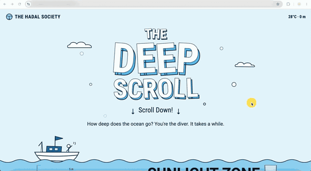
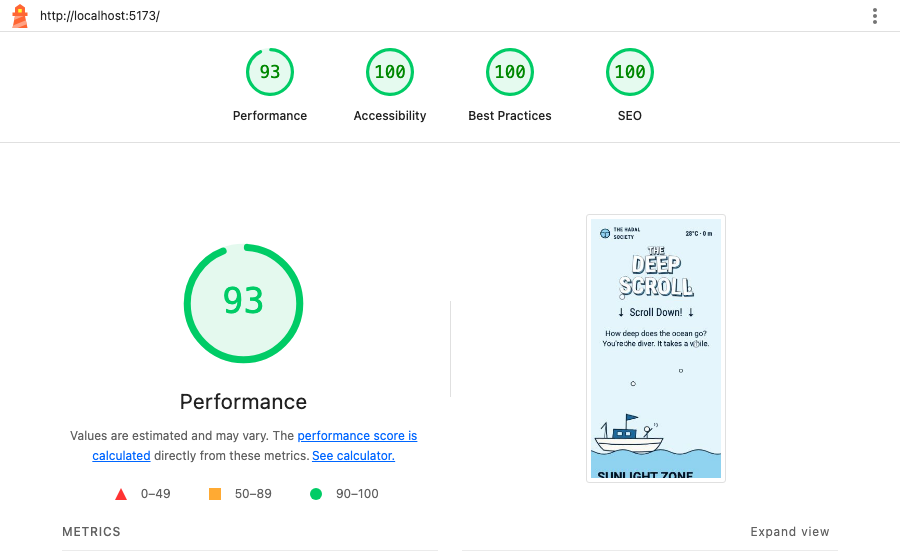
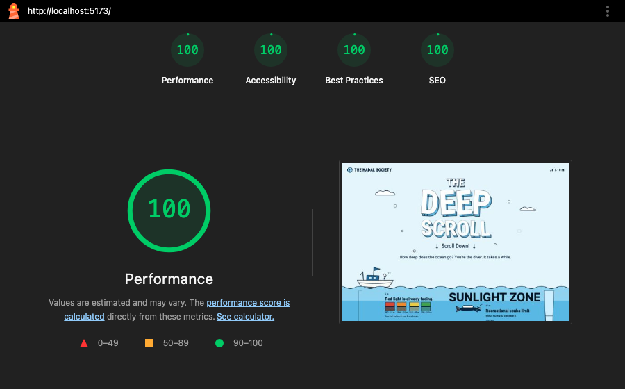

# The Deep Scroll

**How deep does the ocean go? Scroll to find out.**

A landing page for a made-up ocean nonprofit, The Hadal Society.

Scrolling is the dive. You start at the surface and end at the bottom of the
Challenger Deep, 10,935 m down. Animals, wrecks and landmarks show up at their
real depths. The sea gets darker as you go.

The same React components also make a welcome **email**, a **PDF** dive
certificate and a **PNG** share card. All with
[Hyper Elements](https://github.com/hyper-elements/hyper-elements).

<p align="center">
  
</p>

## Lighthouse

Four 90+ scores on phone and desktop, measured on the dev server.

<p align="center">
  
  
</p>

## Run it

```bash
corepack enable  # once: uses the pnpm version pinned in package.json
pnpm install
pnpm dev         # the landing page at http://localhost:5173 (?only=surface for one section)
pnpm render      # writes every output to out/
```

Node 20+. No API keys. No network. Fonts ship in `assets/fonts/`. Without mail
credentials, the welcome email is written to `out/` instead of sent.

## How Hyper Elements is used

One codebase. Four outputs.

| Output           | Root         | Rendered with                  | File                      |
| ---------------- | ------------ | ------------------------------ | ------------------------- |
| Landing page     | `<Page>`     | `render()`                     | `landing-page.html`       |
| Welcome email    | `<Email>`    | `render()` (HTML + plain text) | `welcome-email.html/.txt` |
| Dive certificate | `<Document>` | `renderPdf()` from `/pdf`      | `dive-certificate.pdf`    |
| Share card       | `<Canvas>`   | `renderImage()` from `/image`  | `share-card.png`          |

- **One depth scale.** `depthToY()` turns metres into pixels. Change a depth
  in the data and it moves on the page, the certificate and the share card.
- **Positioning without CSS.** A `Layer` stacks its children. `<Positioned>`
  puts a box at a depth.
- **Drawn, not downloaded.** Every animal is `Svg` shapes (`Path`, `Circle`,
  `Rect`). No images, no gradients, no shadows. It looks the same in HTML, PDF
  and PNG.
- **One theme.** `defineTheme` serves all four roots.

## Project structure

```
src/
  outputs.tsx     The registry of outputs, shared by the dev server and the render script
  modules/        One folder per output (landing-page, welcome-email, dive-certificate, share-card)
  shared/         data, lib, theme, art, ui: used by every module
server/           API routes (welcome email, certificate, share card), run by Vite in dev and Vercel in production
scripts/          render.tsx
```

Modules never import each other. `shared/` never imports a module. ESLint
enforces both (`pnpm lint`).

## Change things

| I want to…             | Edit                                                                       |
| ---------------------- | -------------------------------------------------------------------------- |
| Add or move a creature | `src/shared/data/stops.ts`                                                 |
| Draw a new creature    | `src/shared/art/<name>.tsx`, then register it in `src/shared/art/index.ts` |
| Change colours         | `src/shared/theme/tokens.ts`                                               |
| Add a new output       | a folder in `src/modules/` + one line in `src/outputs.tsx`                 |

`pnpm check` runs typecheck, lint, tests, format check and render.

## Optional: send the welcome email

Set `BREVO_API_KEY`, `MAIL_FROM`, `SITE_URL` and `CERTIFICATE_SECRET` (see
`.env.example`). Mail goes through `sendMail()` in `server/mail.ts`.

## Facts and credits

Every number has a source in [docs/sources.md](docs/sources.md) or is marked
approximate (`~`). The Hadal Society is fictional. The depths are real. Fonts:
Roboto and Roboto Condensed (SIL OFL). Code: MIT.
