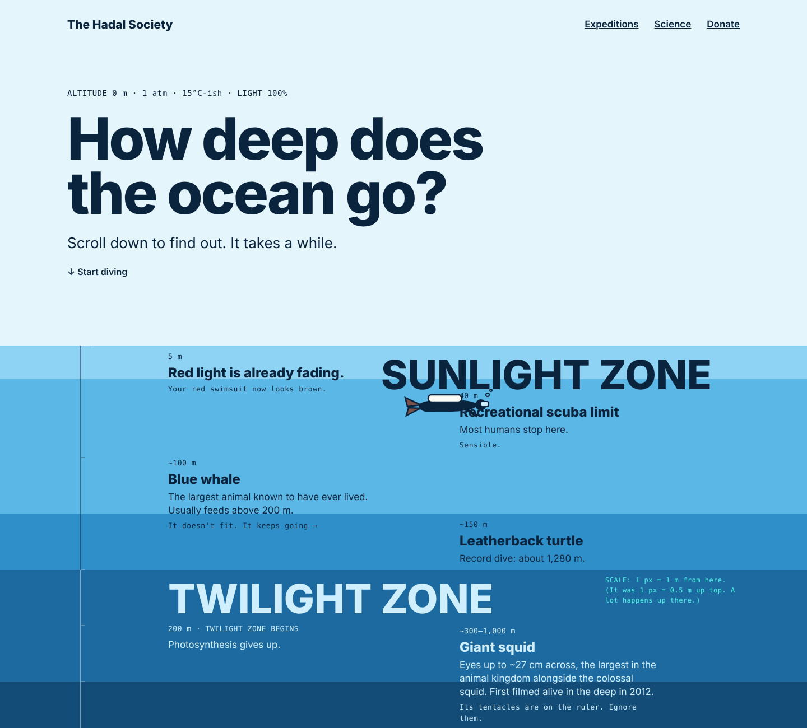

# The Deep Scroll

**How deep does the ocean go? Scroll down to find out.**

A landing page for a fictional ocean nonprofit, The Hadal Society, where
scrolling _is_ the descent: from the sea surface to the bottom of the
Challenger Deep, 10,935 m down. Animals, wrecks and landmarks appear at their
real depths beside a depth ruler, and the sea darkens band by band.

The same React components also render a welcome **email**, a **PDF** dive
certificate and a **PNG** share card. Everything is built with
[Hyper Elements](https://github.com/hyper-elements/hyper-elements).

 <!-- TODO: replace with a scrolling GIF once the art is ported -->

## Run it

```bash
corepack enable  # once: uses the pnpm version pinned in package.json
pnpm install
pnpm dev      # the landing page at http://localhost:5173 (add ?only=surface for one section)
pnpm render   # writes out/landing-page.html, welcome-email.html, dive-certificate.pdf, share-card.png
```

Node 20+ and pnpm (pinned via `packageManager`; `corepack enable` picks it up). React 19. No API keys, no network needed for the PDF and PNG (fonts are in `assets/fonts/`).

## How Hyper Elements is used

| Output           | Root         | Rendered with                  | File                      |
| ---------------- | ------------ | ------------------------------ | ------------------------- |
| Landing page     | `<Page>`     | `render()`                     | `landing-page.html`       |
| Welcome email    | `<Email>`    | `render()` (HTML + plain text) | `welcome-email.html/.txt` |
| Dive certificate | `<Document>` | `renderPdf()` from `/pdf`      | `dive-certificate.pdf`    |
| Share card       | `<Canvas>`   | `renderImage()` from `/image`  | `share-card.png`          |

- **One depth scale drives everything.** `depthToY()` turns metres into pixels.
  Every stop, ruler tick and band is placed from the data files, so changing a
  depth moves it on the page, the certificate and the share card.
- **Absolute positioning without CSS.** A `Layer` stacks its children in one
  cell; a `Column` padded by `(top, left)` inside it acts like an absolutely
  positioned box (`src/shared/ui/positioned.tsx`). One `Layer` holds the
  full-bleed bands, and a centred `Layer` on top holds the ruler and every stop.
- **Drawn, not downloaded.** All art is `Svg` shapes (`Path`, `Circle`, `Rect`…),
  so it's identical in HTML, PDF and PNG. The glow is concentric circles at
  falling opacity. No images, gradients or shadows.
- **One theme** (`defineTheme`) for all four roots.

## Sharing to LinkedIn

Two icons below the footer text: LinkedIn and Download card. If the certificate form has a name, the links carry it.

- LinkedIn reads the card from the shared page's Open Graph tags (`og:image` etc.), not from an upload. `Page` only sets `title` and `description`, so `server/share-meta.ts` adds the tags to the rendered page. The `og:image` URL is absolute: set `SITE_URL` (see `.env.example`) to the public address; LinkedIn cannot reach `localhost`.
- `GET /api/share-card?name=&depth=` returns the card as a PNG (cached for a day). `?name=` on the page URL puts that name on the card.
- **LinkedIn caches the card.** After changing it, refresh the cache with the [Post Inspector](https://www.linkedin.com/post-inspector/).

## Project structure

```
assets/fonts/            TTFs (OFL) for the PDF and PNG
scripts/render.tsx       Renders every output to out/
src/
  outputs.tsx            The registry of outputs: used by the dev server and the render script
  modules/               One folder per output. Modules never import each other.
    landing-page/          <Page>: sections/surface, descent, the-bottom
    welcome-email/         <Email>
    dive-certificate/      <Document>
    share-card/            <Canvas>
  shared/                Used by every module. Never imports a module.
    data/                  Content: stops (creatures & facts), zones & bands, site copy
    lib/                   Pure logic: depth scale, formatting, seeded random
    theme/                 Tokens, theme, web fonts
    art/                   Svg drawings (one file per creature) + registry
    ui/                    Small Hyper Elements building blocks
```

These boundaries are enforced by ESLint (`eslint-plugin-boundaries`).

## Change things

| I want to…                       | Edit                                                                       |
| -------------------------------- | -------------------------------------------------------------------------- |
| Add or move a creature           | `src/shared/data/stops.ts` (depth, side, copy, `art`)                      |
| Draw a new creature              | `src/shared/art/<name>.tsx`, then register it in `src/shared/art/index.ts` |
| Change colours                   | `src/shared/theme/tokens.ts`                                               |
| Change fonts                     | `src/shared/theme/fonts.ts` (+ the TTF in `assets/fonts/`)                 |
| Change where the scale speeds up | `src/shared/lib/sea.ts`                                                    |
| Add a new output                 | a folder in `src/modules/` + one line in `src/outputs.tsx`                 |

## Scripts

| Script           | Does                                       |
| ---------------- | ------------------------------------------ |
| `pnpm dev`       | Landing page dev server, reloads on edit   |
| `pnpm render`    | All outputs to `out/`                      |
| `pnpm typecheck` | `tsc --noEmit`                             |
| `pnpm lint`      | ESLint, including the architecture rules   |
| `pnpm format`    | Prettier                                   |
| `pnpm test`      | Unit tests (Node test runner via tsx)      |
| `pnpm check`     | typecheck + lint + tests + format + render |

## Credits

The Hadal Society is fictional. The depths are real. Fonts: Roboto and
Roboto Condensed (SIL Open Font License, in `assets/fonts/`). Code: MIT.
